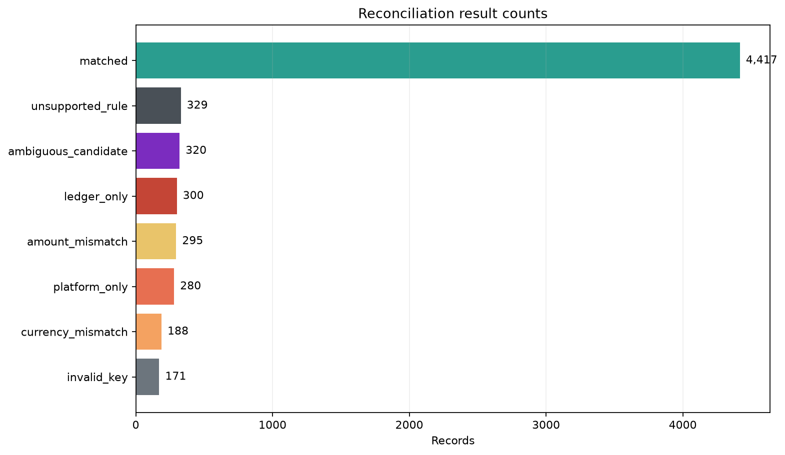
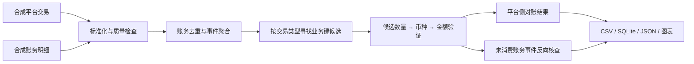
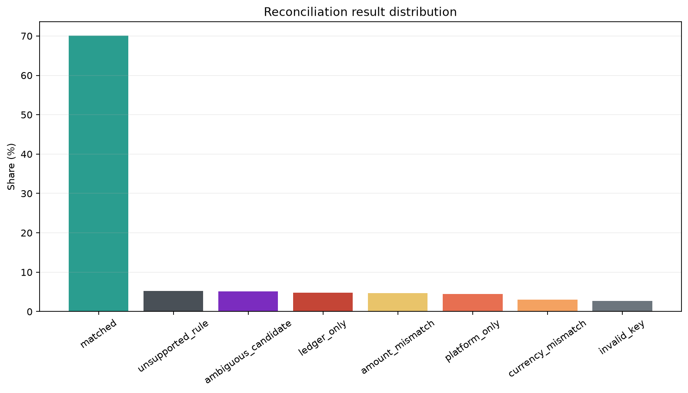
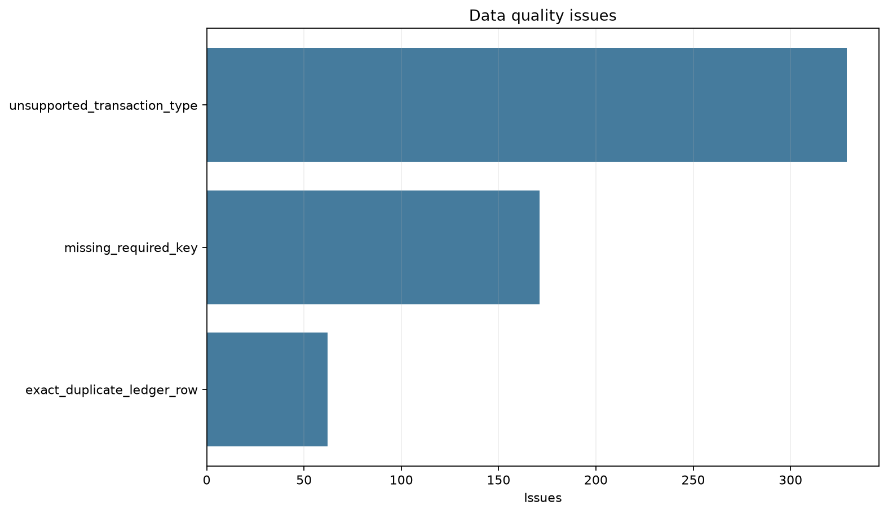

# 财务数据自动对账｜Financial Data Reconciliation

基于 Python、Pandas 与 SQLite 的财务对账分析项目，使用可复现的合成数据，演示从平台交易与内部账务明细的标准化、粒度对齐、业务键匹配，到差异分类和异常追溯的完整流程。

[中文说明](#中文) · [English](#english) · [核查方法](docs/methodology.md) · [数据字典](docs/data_dictionary.md)

> 全部数据由固定随机种子生成，用于作品展示与方法验证，不包含真实客户、雇主数据或生产凭据。



## 中文

### ✨ 核心功能

| 模块 | 实现内容 |
| --- | --- |
| 合成数据生成 | 固定种子生成交易、账务明细及注入场景标签 |
| 数据标准化 | 保留字符串 ID，统一日期、币种及文本，使用 Decimal 解析金额 |
| 数据质量检查 | 缺失键、无效日期与金额、未知类型、重复标识及重复账务内容 |
| 一对多聚合 | 账务组件先按事件、业务键与币种聚合，再参与匹配 |
| 分类匹配 | 销售、退款、调整、账户费用分别使用业务键 |
| 双向核查 | 每笔平台交易输出判断，追加未被消费的账务事件 |
| 异常追溯 | 输出来源标识、候选数量、金额及差异原因 |
| 结果展示 | CSV、SQLite、PNG 图表与 JSON 指标；另附 Excel 示例报告 |

### 📌 业务背景与处理原则

平台报表可能用一行净额表示交易，而内部账务把同一事件拆成多个金额组件。直接逐行连接容易重复累计；仅凭金额相近寻找记录，也可能产生错误匹配。

本项目先对齐数据粒度，再通过业务键寻找候选，依次检查候选数量、币种和金额。金额用于验证，不作为交易身份标识；多个候选保留为歧义结果，供人工复核。

### 🛠 技术栈

| 技术 | 用途 |
| --- | --- |
| Python 3.10+ / Pandas | 数据生成、清洗、聚合与对账 |
| Decimal / 整数分 | 金额解析及聚合比较 |
| SQLite / SQL | 本地数据落库与分析查询 |
| Matplotlib | 对账数量、占比和数据质量图表 |
| Pytest | 标准化、生成器与对账规则测试 |
| setuptools | 项目安装和命令行入口 |

### 🏗 处理流程



详细规则见[方法文档](docs/methodology.md)。歧义候选在匹配尝试中标记为已消费，避免再次错误计入账务单边记录。

### 📊 数据粒度与匹配规则

| 数据层 | 一行代表 |
| --- | --- |
| `platform_transactions` | 一笔平台交易净额 |
| `ledger_entries` | 一个账务金额组件 |
| 账务聚合层 | 一个事件及业务键、币种组合 |
| `reconciliation_results` | 一次平台侧判断或一个账务单边事件 |

| 交易类型 | 候选业务键 |
| --- | --- |
| `SALE` / `REFUND` | 订单 ID + 商品编码 + Marketplace + 交易类型 |
| `ADJUSTMENT` | 商品编码 + Marketplace + 交易类型 + 交易日期 |
| `ACCOUNT_FEE` | 账户 ID + Marketplace + 交易类型 + 结算批次 |

当前运行规则定义在 `src/financial_reconciliation/rules.py`。`config/` 中的 YAML 是规则说明文件，当前引擎未加载它们，修改 YAML 不会直接改变运行行为。

### 🔎 对账结果与示例数据

下列数据来自仓库现有的 [run_metrics.json](reports/run_metrics.json)，对应种子 `20261026`，属于合成演示结果。

| 输入与输出规模 | 数量 |
| --- | ---: |
| 平台交易 | 6,000 |
| 账务明细 | 9,771 |
| 聚合账务事件 | 5,676 |
| 双向对账结果 | 6,300 |

| 结果分类 | 含义 | 数量 |
| --- | --- | ---: |
| `matched` | 匹配通过 | 4,417 |
| `amount_mismatch` | 金额差异 | 295 |
| `currency_mismatch` | 币种差异 | 188 |
| `platform_only` | 仅平台存在 | 280 |
| `ledger_only` | 仅账务存在 | 300 |
| `ambiguous_candidate` | 多候选歧义 | 320 |
| `invalid_key` | 业务键无效 | 171 |
| `unsupported_rule` | 未支持的交易类型 | 329 |

6,300 条结果由 6,000 条平台判断和 300 条账务单边事件组成。数据质量报告另记录 562 项问题，其中包含 62 条重复账务内容；重复内容在事件聚合前明确排除。质量问题数与对账结果数口径不同，不能相加作为交易总数。





### 🚀 本地运行

在仓库根目录执行：

```bash
python -m venv .venv
```

Windows PowerShell：

```powershell
.\.venv\Scripts\Activate.ps1
```

macOS / Linux：

```bash
source .venv/bin/activate
```

安装并运行：

```bash
python -m pip install -e ".[dev]"
python -m financial_reconciliation.cli all --root . --rows 6000 --seed 20261026
python -m pytest
```

安装后也可使用 `reconcile-finance all --root . --rows 6000 --seed 20261026`。`--root` 应指向含 `sql/01_create_tables.sql` 的项目目录。

运行会重新生成 `data/generated/` 内的合成输入和 SQLite 数据库，并覆盖对应的 CSV、JSON 与图表输出。标准 CLI 不会重新生成仓库附带的格式化 Excel 报告；更改种子或行数后，该 Excel 示例不应视作本次运行结果。

### 📂 项目结构

```text
.
├── src/financial_reconciliation/
│   ├── cli.py             # 命令行与流水线编排
│   ├── generate_data.py   # 合成数据生成
│   ├── normalize.py       # 标准化
│   ├── rules.py           # 运行时业务键规则
│   ├── reconcile.py       # 质量检查、聚合、匹配与分类
│   ├── database.py        # SQLite 读写
│   └── report.py          # CSV、JSON 与图表输出
├── config/                # YAML 规则说明
├── sql/                   # 建表、对账分析与质量检查 SQL
├── tests/                 # 自动化测试
├── docs/                  # 方法、字段、隐私及发布说明
├── data/generated/        # 合成输入、场景标签与 SQLite
├── reports/               # 报告、图表及运行指标
├── pyproject.toml
├── SECURITY.md
└── LICENSE
```

### 📑 输出与测试

| 文件 | 用途 |
| --- | --- |
| `reports/reconciliation_results.csv` | 完整可追溯判断明细 |
| `reports/reconciliation_summary.csv` | 结果数量及占比 |
| `reports/data_quality_issues.csv` | 行级质量问题 |
| `reports/data_quality_summary.csv` | 质量分类统计 |
| `reports/run_metrics.json` | 输入规模、种子及结果指标 |
| `reports/figures/` | 对账与数据质量图表 |
| `reports/reconciliation_report.xlsx` | 仓库附带的格式化示例报告 |

仓库原有测试记录为 **14 项通过**，见 [test_report.txt](reports/test_report.txt)。测试覆盖 ID 精度、Decimal 金额、一对多聚合、金额与币种差异、歧义候选、双向缺失、重复处理、未知规则及数量守恒。该记录是已有执行结果，不代表每次修改 README 都重新运行了业务测试。

### 🔒 隐私、边界与改进方向

数据由代码生成，不读取真实业务系统。详见[隐私说明](docs/privacy_and_synthetic_data.md)与[安全说明](SECURITY.md)。项目采用 [MIT License](LICENSE)。

当前版本是本地分析演示，业务键经过简化，未实现外汇换算、跨期日期容差、结算结转或生产级调度与并发控制；合成异常比例不代表真实业务分布。

后续可完善 YAML 配置加载及校验、Excel 自动导出、跨期对账与汇率模块，并增加大规模数据性能验证。

---

## English

### Project overview

This portfolio project demonstrates an end-to-end financial data reconciliation workflow for a fictional marketplace. It compares a platform transaction extract with an internal ledger, aligns different data grains, applies transaction-specific business keys, validates currency and amount, and produces traceable exception reports.

All data is deterministic and synthetic. The project contains no employer data, customer data, production credentials, internal system names, or proprietary mapping rules.

### Business problem

Platform reports often store one net transaction per row, while an accounting or operational ledger can split the same event across several amount lines. A direct row-to-row join can double-count values, miss valid one-to-many relationships, or create false matches based only on similar amounts.

This project uses the following sequence:

1. Normalize identifiers, dates, text, currencies, and decimal amounts.
2. Check missing keys, invalid values, unsupported types, and exact duplicates.
3. Aggregate ledger lines to the event grain.
4. Find candidates using a configured business key for each transaction type.
5. Validate candidate count, currency, and amount in that order.
6. Add reverse-side ledger exceptions that have no platform record.
7. Export reasons, identifiers, candidate counts, and amounts for audit.

### Technology stack

- Python 3.10+
- Pandas
- SQLite and SQL
- `decimal.Decimal` for financial amounts
- Matplotlib
- Pytest
- CSV and Excel reporting

### Data model and grain

| Dataset | Grain | Example role |
|---|---|---|
| `platform_transactions` | One platform transaction record | Source-side net transaction |
| `ledger_entries` | One amount component within a ledger event | One-to-many accounting detail |
| Aggregated ledger events | One `event_id` and business key | Candidate used for reconciliation |
| `reconciliation_results` | One platform decision, plus unmatched ledger events | Final auditable result |

Generic transaction rules:

| Transaction type | Candidate business key |
|---|---|
| `SALE`, `REFUND` | order ID + item code + marketplace + transaction type |
| `ADJUSTMENT` | item code + marketplace + transaction type + transaction date |
| `ACCOUNT_FEE` | account ID + marketplace + transaction type + settlement batch |

Amount is never used to identify a transaction. It is checked only after the business-key candidate is selected.

### Result classifications

- `matched`
- `amount_mismatch`
- `currency_mismatch`
- `platform_only`
- `ledger_only`
- `ambiguous_candidate`
- `invalid_key`
- `unsupported_rule`

### Synthetic run results

The committed example was generated with seed `20261026`.

| Metric | Result |
|---|---:|
| Platform transactions | 6,000 |
| Ledger detail rows | 9,771 |
| Aggregated ledger events | 5,676 |
| Reconciliation decisions | 6,300 |
| Matched | 4,417 |
| Amount mismatch | 295 |
| Currency mismatch | 188 |
| Platform only | 280 |
| Ledger only | 300 |
| Ambiguous candidate | 320 |
| Invalid key | 171 |
| Unsupported rule | 329 |

The 6,300 decisions equal 6,000 platform decisions plus 300 reverse-side ledger-only events. Exact duplicate ledger rows are reported as data-quality issues and explicitly excluded from event aggregation.


### Repository outputs

- `reports/reconciliation_results.csv`: complete traceable decision set
- `reports/reconciliation_summary.csv`: result counts and shares
- `reports/data_quality_issues.csv`: row-level quality exceptions
- `reports/data_quality_summary.csv`: quality issue counts
- `reports/reconciliation_report.xlsx`: formatted summary, full detail, quality issues, and methodology
- `data/generated/*.csv`: deterministic synthetic source data and injected-scenario truth labels

### Run locally

```bash
python -m venv .venv
.venv\Scripts\activate
pip install -e ".[dev]"
python -m financial_reconciliation.cli all --root . --rows 6000 --seed 20261026
pytest
```

On macOS or Linux, activate the environment with `source .venv/bin/activate`.

The standard CLI regenerates synthetic CSV data, SQLite tables, reconciliation CSV files, and PNG charts. The formatted example Excel workbook is included as a portfolio output.

### Test result

The committed historical test record reports:

```text
14 passed in 0.86s
```

Tests cover identifier precision, decimal arithmetic, one-to-many aggregation, amount and currency checks, ambiguous candidates, bidirectional missing records, duplicate handling, unsupported rules, and result-count conservation.

### Known limitations

- This is an analytical demonstration, not a production accounting control.
- Business keys are intentionally generic and simplified.
- The project does not implement foreign-exchange conversion.
- Date tolerances and settlement-period carry-forwards are not modeled.
- The SQLite demo is single-process and not designed for production scale.
- Synthetic scenario proportions are designed for visibility, not to represent a real business distribution.

### Privacy

The generator creates every identifier and amount from code using a fixed random seed. It does not read an external dataset, database, API, shared drive, or confidential project folder. See [Privacy and synthetic data](docs/privacy_and_synthetic_data.md).

